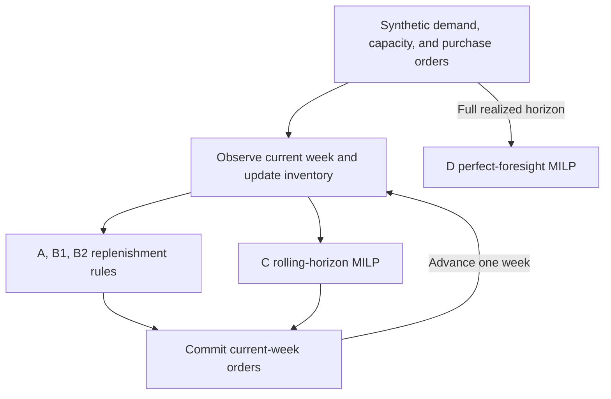

# Procurement and Inventory Planning for U.S. Clean Tech Manufacturing

**A Rolling-Horizon MILP for a Synthetic Battery Storage Case**

[](https://www.python.org/downloads/)
[](https://highs.dev/)
[](#non-anticipative-monte-carlo-stress-test)
[](https://opensource.org/licenses/MIT)
[](#empirical-calibration--governing-standards)

## Overview

This repository accompanies the white paper *Procurement and Inventory Planning for U.S. Clean Tech Manufacturing*. It contains a synthetic supply-chain dataset, a rolling-horizon mixed-integer linear programming (MILP) model, and three replenishment heuristics.

The benchmark follows a U.S. battery energy storage system (BESS) assembly plant over **26 weeks**. It covers six components for a 100 kWh enclosure, four suppliers across three regions, and 68 component-specific supply lanes. In the base case, an unannounced port disruption reduces offshore ordering capacity to 15% of normal in weeks 11–14. Forecast assembly demand rises in weeks 14–19 and peaks at 64 systems per week, compared with the usual 45.

- **95.26% on-time component fill** for the rolling-horizon MILP in the base case and **94.38% on average** across 132 matched scenarios.
- **77.63% lower modeled total cost** than the static ocean policy in the base case, including backlog penalties. Cost before penalties was **USD 18.95M** for the rolling MILP and **USD 13.03M** for static ocean.
- **27.05% lower modeled total cost** when the backlog penalty is reduced to one-tenth of its base value and the rolling policy is reoptimized.

## Repository Structure

```text
milp-supply-chain-resilience/
├── data/
│   ├── components.csv                       # Six components for a 100 kWh BESS and their cost and weight inputs
│   ├── suppliers_lanes.csv                  # 68 component-specific supplier and freight options
│   ├── weekly_demand_capacity.csv           # 26-week demand forecasts, realized demand, and supplier capacity
│   └── in_transit_pipeline.csv              # Pre-horizon purchase orders scheduled to arrive in weeks 1–4
├── figures/
│   ├── fig1_cost_breakdown_benchmark.png    # Five-policy cost breakdown and on-time component fill rate
│   ├── fig2_inventory_disruption_dynamics.png # LFP module inventory and backlog during the base disruption
│   ├── fig3_sourcing_mix_and_montecarlo.png   # Regional sourcing mix and modeled savings across 132 scenarios
│   └── fig4_policy_sensitivity_frontier.png  # Perfect-foresight sensitivity to modeled discounts and tariffs
├── results/
│   ├── benchmark_comparison.csv             # 26-week financial and operational results for five policies
│   ├── monte_carlo_stress_test.csv           # 132 port-strike and demand scenarios
│   └── backlog_penalty_sensitivity.csv      # Base-case results at four backlog penalty levels
├── src/
│   ├── generate_supply_chain_data.py        # Synthetic BESS benchmark generator (seed=42)
│   ├── optimize_inventory_milp.py           # HiGHS rolling-horizon MILP, heuristics, and stress test
│   └── test_inventory_timing.py             # Lead-time, horizon, backlog, and FIFO fill-rate tests
├── requirements.txt                         # Tested Python dependency versions
└── README.md                               # Project overview and reproducibility instructions
```

## Optimization & Simulation Architecture

Policies A, B1, B2, and C use the same end-of-week decision timing. Each policy receives scheduled shipments, serves carried backlog ahead of current demand, observes the week’s supplier capacity, then places orders. Policy C forecasts demand and capacity for the remaining weeks, carries open orders into the next planning run, and commits only the current week’s decisions. During a strike, it forecasts one additional week of reduced capacity and updates that forecast as new observations arrive.



| Policy | Ordering method |
| --- | --- |
| **A · Static ocean** | One offshore ocean lane per component with a min-max replenishment rule |
| **B1 · Reactive air** | Static ocean with reactive air expediting on eligible lanes |
| **B2 · Three-region heuristic** | Selected U.S., Mexican, and offshore lanes using reorder and coverage rules |
| **C · Rolling-horizon MILP** | Weekly reoptimization across all eligible lanes with forecast inventory and storage constraints |
| **D · Perfect-foresight reference** | Full-horizon MILP with realized demand and capacity visible to the solver |

## Mathematical Formulation (MILP Architecture)

### Sets, Indices & Decision Variables

- $i$ denotes a component, $l \in \mathcal{L}_i$ a supplier and freight lane for that component, and $t$ an order week.
- $`N_{l,t} \in \mathbb{Z}_{\ge 0}`$ is the number of whole lots ordered on lane $`l`$ in week $`t`$. The binary variable $`Y_{l,t} \in \{0,1\}`$ equals 1 if the lane is used that week and 0 otherwise.
- $I_{i,t}, B_{i,t} \ge 0$ are ending on-hand inventory and outstanding backlog, in component units.

### Objective Function & Operational Constraints

Minimize purchase, modeled duties and discounts, freight, fixed order fees, inventory holding, and weekly backlog penalties. Here $c_l$ is net variable cost per unit, $K_l$ is the fixed order fee, $h_i$ is the holding rate, and $p_i$ is the backlog penalty rate.

```math
\min \sum_t \left[
  \sum_l \left(c_l q_l N_{l,t} + K_l Y_{l,t}\right)
  + \sum_i \left(h_i I_{i,t} + p_i B_{i,t}\right)
\right]
```

Lot size $q_l$ is the smallest of the usable-volume limit, gross-payload limit, and commercial lot cap. The model applies minimum and maximum lot bounds, supplier capacity limits, and a **480 m³** cap on projected end-of-week inventory. Standard freight is capped at standard capacity. Where air is available, combined standard and air order quantity is subject to a shared supplier quantity limit of 1.5 times that capacity.

Inventory balance includes pre-horizon receipts $\bar{Q}_{i,t}$ and orders placed $L_l$ weeks earlier. A one-week lead means an order placed at the end of week $t$ arrives in week $t+1$.

```math
I_{i,t} - B_{i,t} =
  I_{i,t-1} - B_{i,t-1} + \bar{Q}_{i,t}
  + \sum_{l \in \mathcal{L}_i:\, t-L_l \ge 1} q_l N_{l,t-L_l}
  - D_{i,t}
```

The simulation excludes orders arriving after week 26 and scores ending inventory and backlog without a terminal safety-stock target. On-time component fill uses FIFO fulfillment. New unmet demand equals the smaller of ending backlog and current-period demand.

## Summary of Results & Visual Findings

### Deterministic 26-Week Five-Policy Benchmark

| Policy | Cost before backlog penalty (USD) | Backlog penalty (USD) | Modeled total cost (USD) | On-time component fill | Peak warehouse use |
| --- | ---: | ---: | ---: | ---: | ---: |
| A · Static ocean | 13.03M | 87.32M | 100.35M | 31.10% | 35.04% |
| B1 · Reactive air | 21.58M | 31.67M | 53.25M | 56.91% | 52.36% |
| B2 · Three-region heuristic | 15.44M | 57.22M | 72.67M | 69.36% | 95.31% |
| **C · Rolling MILP** | **18.95M** | **3.49M** | **22.45M** | **95.26%** | **51.53%** |
| D · Perfect-foresight reference | 18.89M | 3.54M | 22.43M | 95.10% | 57.70% |

Source [`results/benchmark_comparison.csv`](results/benchmark_comparison.csv). Peak warehouse use measures realized end-of-week inventory volume. The C–B2 difference reflects the ordering method, lane access, and planning constraints together.

### Non-Anticipative Monte Carlo Stress Test

The balanced design crosses 11 starting weeks (6–16) with four strike durations (2–5 weeks) and three independent demand paths per combination. Within each scenario, all four operating policies receive the same realized demand and capacity. Weekly demand multipliers have a mean of 1.0 and a standard deviation of 8%.

| Comparison | Mean reduction in modeled total cost |
| --- | ---: |
| C vs. A · Static ocean | 76.90% |
| C vs. B1 · Reactive air | 54.57% |
| C vs. B2 · Three-region heuristic | 69.08% |

Policy C had lower modeled total cost than all three heuristics in **132 of 132** scenarios. These scenarios represent a fixed offshore capacity shock with variable timing, duration, and demand. Transit times and previously scheduled arrivals stay fixed. See [stress-test results](results/monte_carlo_stress_test.csv) and [backlog-penalty sensitivity](results/backlog_penalty_sensitivity.csv).

### Key Diagnostic Visuals

- [Figure 1 · Cost and component fill](figures/fig1_cost_breakdown_benchmark.png) compares costs and fill rates across the five policies.
- [Figure 2 · LFP inventory and backlog](figures/fig2_inventory_disruption_dynamics.png) traces module inventory and outstanding backlog in the base case.
- [Figure 3 · Sourcing and stress-test savings](figures/fig3_sourcing_mix_and_montecarlo.png) shows Policy C’s weekly sourcing mix and paired savings across 132 scenarios.
- [Figure 4 · Perfect-foresight sensitivity](figures/fig4_policy_sensitivity_frontier.png) shows how Policy D’s results change with assumed module discounts and offshore tariff multipliers.

## Quickstart & Reproducibility

### 1. Open the project and install dependencies

Extract the source archive or clone the repository. Run the commands from the project root with Python 3.11 or later.

```bash
git clone https://github.com/chochoju/milp-supply-chain-resilience.git
cd milp-supply-chain-resilience
python -m pip install -r requirements.txt
```

### 2. Regenerate the synthetic data

```bash
python src/generate_supply_chain_data.py
```

The source package includes the generated data. Run this step to regenerate it with seed 42.

### 3. Run tests and reproduce the benchmark

```bash
python -m unittest discover -s src -v
python src/optimize_inventory_milp.py --workers 4
```

The optimizer checks that Policy C makes identical decisions through week 10 when only later outcomes change. It then runs the five-policy comparison, penalty sensitivity, and 132 stress scenarios, writing output to `results/` and `figures/`. Use `--paths-per-strike 1` for a 44-scenario run or omit `--workers` to run serially. Feasible incumbents returned at a time limit can vary by machine.

## Empirical Calibration & Governing Standards

The benchmark combines selected public reference values with synthetic costs, lead times, freight rates, and penalty assumptions.

- **Drayage payloads.** OCEMA recommends cargo limits of 17,780 kg for the modeled 20-ft slider, 19,960 kg for the tri-axle, and 19,820 kg for the 40-ft high-cube configuration. The model adds 7% to net unit weight as a synthetic packaging allowance. [OCEMA and Maersk guidance](https://www.maersk.com/local-information/north-america/united-states-of-america)
- **Battery system cost context.** NREL reports delivered cabinet and system-level power cost parameters for utility-scale storage. The component purchase prices in this benchmark are synthetic. [NREL 2025 cost update](https://doi.org/10.2172/2583471)
- **Tariff and credit assumptions.** Offshore lanes use synthetic tariff proxies of 25% or 50%. The modeled Mexican lanes use a zero-duty assumption. The U.S. module receives a hypothetical USD 250 supplier discount, equivalent to full pass-through of USD 10/kWh for an eligible 25 kWh cell-based module. The modeled PCS discount is zero. [USTR Section 301 notice](https://www.govinfo.gov/app/details/FR-2024-09-18/2024-21217) · [CBP USMCA guidance](https://trade.cbp.gov/USMCA/s/faqs) · [26 U.S.C. § 45X](https://uscode.house.gov/view.xhtml?req=granuleid:USC-prelim-title26-section45X)
- **Air eligibility.** The benchmark excludes air shipments for standalone LFP modules. [PHMSA lithium battery shipping guide](https://www.phmsa.dot.gov/lithiumbatteries)

## Author & Citation

**Juyeon Cho (Jenny)**, M.S. in Business Analytics (Duke University) — *Manufacturing Data & Analytics Engineer*

```bibtex
@misc{milp_supply_chain_resilience_2026,
  author       = {Cho, Juyeon},
  title        = {Procurement and Inventory Planning for U.S. Clean Tech Manufacturing},
  year         = {2026},
  publisher    = {GitHub / Zenodo},
  url          = {https://github.com/chochoju/milp-supply-chain-resilience}
}
```
